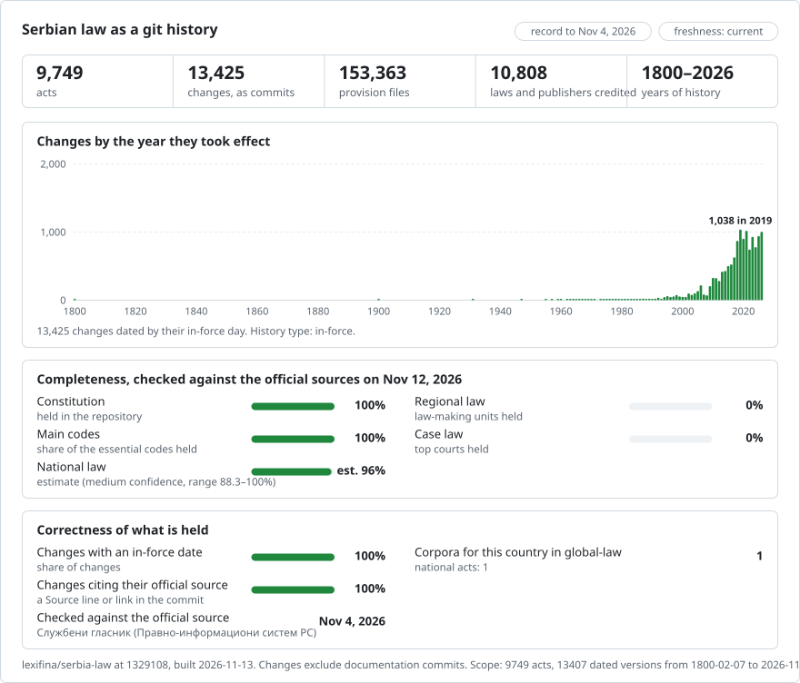

# Serbia: law history in git

[Srpski](README.md) · **English**

<picture>
<source media="(prefers-color-scheme: dark)" srcset="data/effort-dark.svg">

</picture>

The law of Serbia as a git history: one file per provision, one commit per version on the day it took effect, and the act that made each change as the commit's author. `git blame` names the act behind every article; `git log` lists every change to an article; picking a date gives the text in force that day.

Part of [lexifina/global-law](https://github.com/lexifina/global-law), one git history for every country's law: this is Serbia's national law, which global-law reads at `serbia/national/acts/`.

**What is in it now:** the Constitution and 9,748 acts from the official register, with 13,507 versions. [`PLAN.md`](PLAN.md) lists every part this repository is meant to hold (laws, by-laws, local acts, case law, treaties, legislative history) and how far each one is; [`registry/ACTS.md`](registry/ACTS.md) lists every act.

| Folder | Kind | Acts | Versions |
| --- | --- | ---: | ---: |
| `ustav/` | Устав Републике Србије (the Constitution) | 1 | 2 |
| `pravilnik/` | Правилник (rulebooks) | 3,291 | 4,656 |
| `odluka/` | Одлука (decisions) | 2,767 | 3,650 |
| `zakon/` | Закон (laws) | 1,649 | 2,335 |
| `uredba/` | Уредба (government decrees) | 1,233 | 1,824 |
| `akt/` | Other acts | 175 | 292 |
| `memorandum/` | Меморандум (memoranda) | 114 | 114 |
| `resenje/` | Решење (rulings) | 95 | 113 |
| `naredba/` | Наредба (orders) | 85 | 93 |
| `sporazum/` | Споразум (agreements) | 80 | 80 |
| `uputstvo/` | Упутство (instructions) | 64 | 65 |
| `tarifa/` | Тарифа (tariffs) | 41 | 51 |
| `statut/` | Статут (statutes) | 34 | 51 |
| `poslovnik/` | Пословник (rules of procedure) | 28 | 43 |
| `kolektivni/` | Колективни уговор (collective agreements) | 25 | 52 |
| `kodeks/` | Кодекс (codes) | 21 | 30 |
| `protokol/` | Протокол (protocols) | 17 | 17 |
| `pravila/` | Правила (rules) | 7 | 7 |
| `zakljucak/` | Закључак (conclusions) | 7 | 16 |
| `ustav/` | Уставни закон (constitutional laws) | 3 | 3 |
| `program/` | Програм (programmes) | 3 | 3 |
| `strategija/` | Стратегија (strategies) | 3 | 6 |
| `metodologija/` | Методологија (methodologies) | 2 | 2 |
| `plan/` | План (plans) | 1 | 1 |
| `konvencija/` | Конвенција (conventions) | 1 | 1 |
| `ugovor/` | Уговор (contracts, treaties) | 1 | 1 |
| `ukaz/` | Указ (decrees) | 1 | 1 |

Each act is in `<kind>/<year>/<Gazette number>-<page>/`, from its first publication (`zakon/2005/24-3/` is the Закон о раду, the Labour Law, "Службени гласник РС" 24/2005, page 3); acts first published in an earlier Gazette carry its name (`sfrj29-1181` is "Службени лист СФРЈ" 29/1978, page 1181). `registry/data/paths.json` maps each act id to its folder.

The text is in Serbian (Cyrillic, some acts Latin), as the official register prints it. An English translation is not part of this record.

## Questions as git commands

| Question | Command |
| --- | --- |
| Every change to Article 1 of the Labour Law | `git log -p --word-diff -- zakon/2005/24-3/clan-001.md` |
| Which act wrote each line of it? | `git blame zakon/2005/24-3/clan-001.md` |
| Every version of the Labour Law, with the day each took effect | `git log --format="%h %(trailers:key=In-force,valueonly,separator=) %an" -- zakon/2005/24-3` |
| Article 1 as it stood in one of those versions | `git show <commit>:zakon/2005/24-3/clan-001.md` |
| Every version in the record, in order | `git log --reverse --format="%ad %an" --date=short main` |

**Or ask in plain words.** The same record is free to use without git, an account or a key:

- **[Ask Claude about Serbian law](https://global-law.lexifina.com/v1/try_claude?country=serbia)**: one click opens Claude with a first question ready (annual leave in the Labour Law, and how it has changed).
- **[Ask ChatGPT](https://global-law.lexifina.com/v1/try_chatgpt?country=serbia)**: the same question in ChatGPT.
- **[Call the API in your browser](https://global-law.lexifina.com/v1/search_law?query=godi%C5%A1nji+odmor&jurisdictions=serbia)**: Serbian law searched for "godišnji odmor", answered as JSON. No key for 5 calls a minute; [every tool](https://global-law.lexifina.com/v1), [keys and documentation](https://lexifina.com/api).

The assistants read it through the free Global law connector (MCP, `https://global-law.lexifina.com/mcp`); the first time, the chat gives the link that adds it. Ask in Serbian, in Latin or Cyrillic letters, or in English.

## Dates

Each commit is dated at noon, Europe/Belgrade, on the day the version took effect, and carries it in its `In-force:` trailer:

- for an act with several versions, the register's own application day for each version (its version timeline);
- for an act the register keeps as one text, the register's ELI date for it, or the day the act's own in-force clause gives (or its last amendment's), counted from the Gazette day the text's header prints;
- for a single text with neither (most are decisions and notices with no in-force clause), the Gazette day of the last publication the text includes, as its header prints it. Every such version says so in a note in its commit message ("The register keeps only this text and gives no day it took effect ..."), and its part file's decisions say which rule gave the day.

The first version of an act is credited to its original publication when it holds only that publication and its corrections; otherwise it is the "oldest version available", credited to the publisher and naming the publications it already includes.

## How it is checked

- Every version is the register's own consolidated text for that version, with the register's change notes (not law text) left out; the units re-join to the register's text line for line.
- Every act is read back from git on the day each version took effect and on the day before, and must match the corpus; only checked batches are pushed. Results are in `registry/REPRODUCE.md`.
- History is append-only: no merge commits, no rewriting, no commit dated in the future, and every commit's trailers parse.

## What it does not show

- **Acts no longer in force.** The register lists acts in force; earlier texts of an act are here where the register keeps them as versions. Repealed acts and texts as first published are planned from the Службени гласник archive (see `PLAN.md`).
- **Images** (forms, tables, formulas drawn as pictures) are not in the files; versions whose text holds them say so.
- **Local acts, case law, treaties' own Gazette texts, bills and drafts** are planned parts (see `PLAN.md`).

## Sources

| Source | Kind | Past versions | Notes |
| --- | --- | --- | --- |
| [Pravno-informacioni sistem Republike Srbije](https://pravno-informacioni-sistem.rs) | Official register (Службени гласник) | yes, a version timeline per act | The text of every version, its application day and the Gazette publications it includes |

## Licence

See `LICENSE`.

This repository is not legal advice and not an official publication. No AI model wrote or changed legal text; scripts were written by an AI model (see `REPRODUCE.md` and `registry/REPRODUCE.md`).

## How current it is

- [FRESHNESS.en.md](FRESHNESS.en.md): how current each source is, source by source, and how global-law sees this repository
- [WATCHING.en.md](WATCHING.en.md): every official source watched for Serbia, what is read on it and when it was last read
- [monitoring/](monitoring/README.en.md): the state of this repository (latest commits, what arrived, what is paused)

The same for every country: [FRESHNESS.md](https://github.com/lexifina/global-law/blob/main/FRESHNESS.md), [WATCHING.md](https://github.com/lexifina/global-law/blob/main/WATCHING.md) and [monitoring/](https://github.com/lexifina/global-law/tree/main/monitoring) in global-law.

## Visualisations

[visualisations/](visualisations/): Serbian law in 20 charts, drawn from this repository: what the National Assembly passes and who lends to Serbia, what the statute book is made of and how often it changes, constitutional complaints, appeals to the Information Commissioner over administrative silence, the State Audit Institution's recommendations and Belgrade's Official Gazette. Open [srpsko-pravo-u-20-grafikona.html](visualisations/srpsko-pravo-u-20-grafikona.html) in a browser; [visualisations/README.en.md](visualisations/README.en.md) shows every chart as an image.

## More

- [vulnerabilities/](vulnerabilities/README.en.md): possible drafting mistakes in Serbian law, found by global-law's detectors and checked by hand

From [lexifina/global-law](https://github.com/lexifina/global-law):

- [FEATURES.md](https://github.com/lexifina/global-law/blob/main/FEATURES.md): every feature, and what every corpus must support (`git blame`, `law.py`, the MCP tools)
- [FAQ.md](https://github.com/lexifina/global-law/blob/main/FAQ.md): questions and answers · [CONTRIBUTING.md](https://github.com/lexifina/global-law/blob/main/CONTRIBUTING.md): proposing changes · [MCP.md](https://github.com/lexifina/global-law/blob/main/MCP.md): the MCP server · [REPRODUCE.md](https://github.com/lexifina/global-law/blob/main/REPRODUCE.md): how it was built · [CHANGELOG.md](https://github.com/lexifina/global-law/blob/main/CHANGELOG.md)
- [FRESHNESS.md](https://github.com/lexifina/global-law/blob/main/FRESHNESS.md): how current each corpus is · [Monitoring](https://github.com/lexifina/global-law/tree/main/monitoring): whether updates are running · [WATCHING.md](https://github.com/lexifina/global-law/blob/main/WATCHING.md): how each official source is watched for changes
- [performance/](https://github.com/lexifina/global-law/tree/main/performance): how fast the tools are, measured
- [visualisations/](https://github.com/lexifina/global-law/tree/main/visualisations): charts and bridges across the world's law
- [Vulnerabilities](https://github.com/lexifina/global-law/tree/main/vulnerabilities): mistakes in legislation as published
