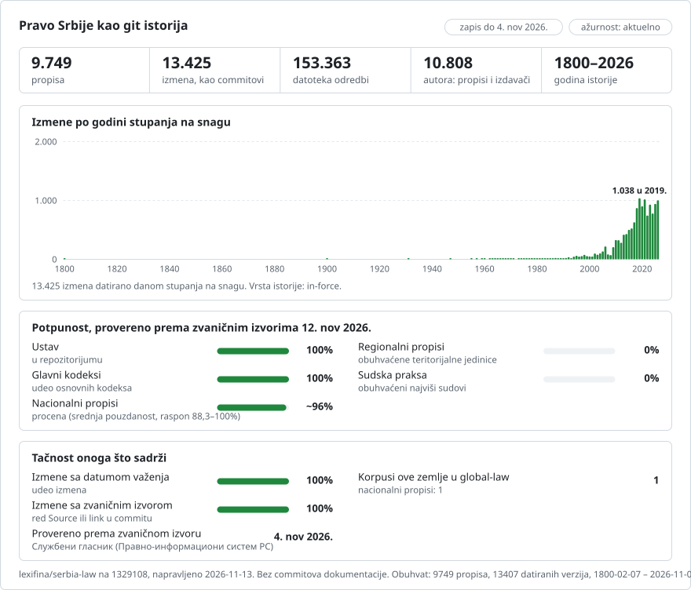

# Srbija: istorija propisa u gitu

**Srpski** · **[Or read it in English](README.en.md)**

<picture>
<source media="(prefers-color-scheme: dark)" srcset="data/sr/effort-dark.svg">

</picture>

Pravo Srbije kao git istorija: jedna datoteka po odredbi, jedan commit po verziji na dan kada je stupila na snagu, a autor svakog commita je propis koji je doneo izmenu. `git blame` pokazuje propis koji stoji iza svakog člana; `git log` navodi svaku izmenu člana; izborom datuma dobija se tekst koji je tog dana bio na snazi.

Deo projekta [lexifina/global-law](https://github.com/lexifina/global-law), jedne git istorije prava svih zemalja: ovo je nacionalno pravo Srbije, koje global-law čita na putanji `serbia/national/acts/`.

**Šta sadrži sada:** Ustav i 9.748 propisa iz zvaničnog registra, sa 13.507 verzija; 4.034 lokalna propisa iz 20 gradova i opština; 12.000 sudskih odluka (od toga 11.521 Ustavnog suda); 1.384 predloga zakona i 178 nacrta, označenih kao tekstovi koji nisu propisi; i 489 odluka i izveštaja drugih javnih organa. [`PLAN.md`](PLAN.md) navodi sve delove koje ovaj repozitorijum treba da sadrži i dokle se stiglo sa svakim; [`registry/ACTS.md`](registry/ACTS.md) navodi sve propise iz registra, po vrsti.

Svaki propis je u `<vrsta>/<godina>/<broj glasnika>-<strana>/`, prema prvom objavljivanju (`zakon/2005/24-3/` je Закон о раду, Zakon o radu, „Службени гласник РС” 24/2005, strana 3); propisi prvi put objavljeni u nekom ranijem glasniku nose njegov naziv (`sfrj29-1181` je „Службени лист СФРЈ” 29/1978, strana 1181). `registry/data/paths.json` povezuje id svakog propisa sa njegovim folderom.

Tekstovi propisa su na srpskom, ćirilicom (neki latinicom), onako kako ih objavljuje zvanični registar. Prevod propisa na engleski nije deo ovog repozitorijuma.

## Pitanja kao git komande

| Pitanje | Komanda |
| --- | --- |
| Svaka izmena člana 1 Zakona o radu | `git log -p --word-diff -- zakon/2005/24-3/clan-001.md` |
| Koji propis je napisao svaki red člana 1? | `git blame zakon/2005/24-3/clan-001.md` |
| Svaka verzija Zakona o radu, sa danom kada je stupila na snagu | `git log --format="%h %(trailers:key=In-force,valueonly,separator=) %an" -- zakon/2005/24-3` |
| Član 1 u jednoj od tih verzija | `git show <commit>:zakon/2005/24-3/clan-001.md` |

**Izvan gita** ove podatke takođe objavljujemo javno i besplatno:

- **[Pitajte Claude o propisima Srbije](https://global-law.lexifina.com/v1/try_claude?country=serbia)**: otvara Claude sa spremnim prvim pitanjem.
- **[Pitajte ChatGPT](https://global-law.lexifina.com/v1/try_chatgpt?country=serbia)**: isto pitanje u ChatGPT-u.
- **[Pozovite API u pregledaču](https://global-law.lexifina.com/v1/search_law?query=godi%C5%A1nji+odmor&jurisdictions=serbia)**: pretraga propisa Srbije za „godišnji odmor”, odgovor u JSON-u. Dokumentacija je [ovde](https://lexifina.com/api/global-law).

Oba asistenta čitaju podatke preko besplatnog konektora Global law (MCP, `https://global-law.lexifina.com/mcp`); prvi put razgovor daje link kojim se konektor dodaje. Pitajte na srpskom, latinicom ili ćirilicom, ili na engleskom.

**Lako ga pokrenite sami.** Dovoljni su git i Python, a alati rade na vašem računaru:

```sh
git clone --depth 1 https://github.com/lexifina/global-law && cd global-law
python3 tools/countries.py add serbia/national/acts
python3 tools/law.py show 2026-01-01 serbia/national/acts/zakon/2005/24-3/clan-001.md
```

Otvoren u Claude Code-u, Cursoru, VS Code-u ili Codexu, klon pokreće i lokalni MCP server sa istim alatima ([MCP.md](https://github.com/lexifina/global-law/blob/main/MCP.md)).

## Datumi

Svaki commit nosi datum u podne po beogradskom vremenu (Europe/Belgrade), na dan kada je verzija stupila na snagu, a taj dan stoji i u njegovom `In-force:` traileru:

- za propis sa više verzija, dan primene svake verzije koji navodi sam registar (njegova vremenska linija verzija);
- za propis koji registar čuva kao jedan tekst, ELI datum koji registar daje za njega, ili dan koji navodi odredba propisa o stupanju na snagu (ili odredba njegove poslednje izmene), računato od dana izlaska glasnika odštampanog u zaglavlju teksta;
- za jedan tekst bez ijednog od tih podataka (uglavnom odluke i obaveštenja bez odredbe o stupanju na snagu), dan izlaska glasnika sa poslednjom objavom koju tekst obuhvata, kako je odštampan u zaglavlju. Svaka takva verzija to navodi u napomeni u poruci commita („The register keeps only this text and gives no day it took effect ...”), a odluke u datoteci njenog dela navode koje je pravilo dalo dan.

Prva verzija propisa pripisuje se njegovom prvobitnom objavljivanju kada sadrži samo to objavljivanje i njegove ispravke; u suprotnom je to „najstarija dostupna verzija”, pripisana izdavaču, i navodi objave koje već obuhvata.

## Koliko je ažurno

- [FRESHNESS.md](FRESHNESS.md): koliko je svaki izvor ažuran, izvor po izvor, i kako ovaj repozitorijum vidi global-law
- [WATCHING.md](WATCHING.md): svaki zvanični izvor koji se prati za Srbiju, šta se na njemu čita i kada je poslednji put pročitan
- [monitoring/](monitoring/): stanje ovog repozitorijuma (poslednji komitovi, šta je stiglo, šta je pauzirano)

## Kako se proverava

- Svaka verzija je prečišćeni tekst te verzije iz samog registra, bez napomena registra o izmenama (one nisu tekst propisa); delovi se ponovo spajaju u tekst registra red po red.
- Svaki propis se čita iz gita na dan stupanja na snagu svake verzije i na dan pre toga, i mora se poklapati sa korpusom; objavljuju se samo provereni paketi. Rezultati su u `registry/REPRODUCE.md`.
- Istorija se samo dopisuje: nema merge commitova, nema prepravljanja istorije, nema commita sa datumom u budućnosti, a traileri svakog commita su ispravnog formata.
- [vulnerabilities/](vulnerabilities/): moguće greške u propisima Srbije, koje su pronašli detektori iz global-law i koje su ručno proverene.

## Šta ne prikazuje

- **Propise koji više nisu na snazi.** Registar navodi propise na snazi; raniji tekstovi propisa su ovde ako ih registar čuva kao verzije. Ukinuti propisi i tekstovi u obliku u kome su prvi put objavljeni planirani su iz arhive Službenog glasnika (vidi `PLAN.md`).
- **Slike** (obrasci, tabele i formule u obliku slika) nisu u datotekama; verzije čiji tekst ih sadrži to navode.
- **Lokalne propise, sudsku praksu, tekstove međunarodnih ugovora iz glasnika, predloge i nacrte zakona**: to su planirani delovi (vidi `PLAN.md`).

## Izvori

| Izvor | Vrsta | Ranije verzije | Napomene |
| --- | --- | --- | --- |
| [Pravno-informacioni sistem Republike Srbije](https://pravno-informacioni-sistem.rs) | Zvanični registar (Službeni glasnik) | da, vremenska linija verzija za svaki propis | Tekst svake verzije, dan njene primene i objave u glasniku koje obuhvata |

## Licenca

Vidi `LICENSE`.

Ovaj repozitorijum nije pravni savet niti zvanična publikacija. Nijedan AI model nije pisao niti menjao tekst propisa; skripte je napisao AI model (vidi `REPRODUCE.md` i `registry/REPRODUCE.md`).

Ovo je prevod engleske verzije ([README.en.md](README.en.md)); ako se razlikuju, važi engleska verzija.

## Vizualizacije

[visualisations/](visualisations/): srpsko pravo u 20 grafikona, nacrtanih iz ovog repozitorijuma: šta Narodna skupština usvaja i ko pozajmljuje Srbiji, od čega se sastoji pravni poredak i koliko se često menja, ustavne žalbe, žalbe Povereniku zbog ćutanja uprave, preporuke Državne revizorske institucije i Službeni list Grada Beograda. Otvorite [srpsko-pravo-u-20-grafikona.html](visualisations/srpsko-pravo-u-20-grafikona.html) u pregledaču; [visualisations/README.md](visualisations/README.md) prikazuje svaki grafikon kao sliku.

## Više

Iz repozitorijuma [lexifina/global-law](https://github.com/lexifina/global-law) (na engleskom):

- [FEATURES.md](https://github.com/lexifina/global-law/blob/main/FEATURES.md): sve funkcije i šta svaki korpus mora da podržava (`git blame`, `law.py`, MCP alati)
- [FAQ.md](https://github.com/lexifina/global-law/blob/main/FAQ.md): pitanja i odgovori · [CONTRIBUTING.md](https://github.com/lexifina/global-law/blob/main/CONTRIBUTING.md): predlaganje izmena · [MCP.md](https://github.com/lexifina/global-law/blob/main/MCP.md): MCP server · [REPRODUCE.md](https://github.com/lexifina/global-law/blob/main/REPRODUCE.md): kako je napravljen · [CHANGELOG.md](https://github.com/lexifina/global-law/blob/main/CHANGELOG.md)
- [FRESHNESS.md](https://github.com/lexifina/global-law/blob/main/FRESHNESS.md): koliko je ažuran svaki korpus · [Praćenje](https://github.com/lexifina/global-law/tree/main/monitoring): da li ažuriranja rade · [WATCHING.md](https://github.com/lexifina/global-law/blob/main/WATCHING.md): kako se svaki zvanični izvor prati zbog izmena
- [performance/](https://github.com/lexifina/global-law/tree/main/performance): koliko su alati brzi, izmereno
- [visualisations/](https://github.com/lexifina/global-law/tree/main/visualisations): grafikoni i veze kroz pravo celog sveta
- [Ranjivosti](https://github.com/lexifina/global-law/tree/main/vulnerabilities): greške u propisima onako kako su objavljeni
