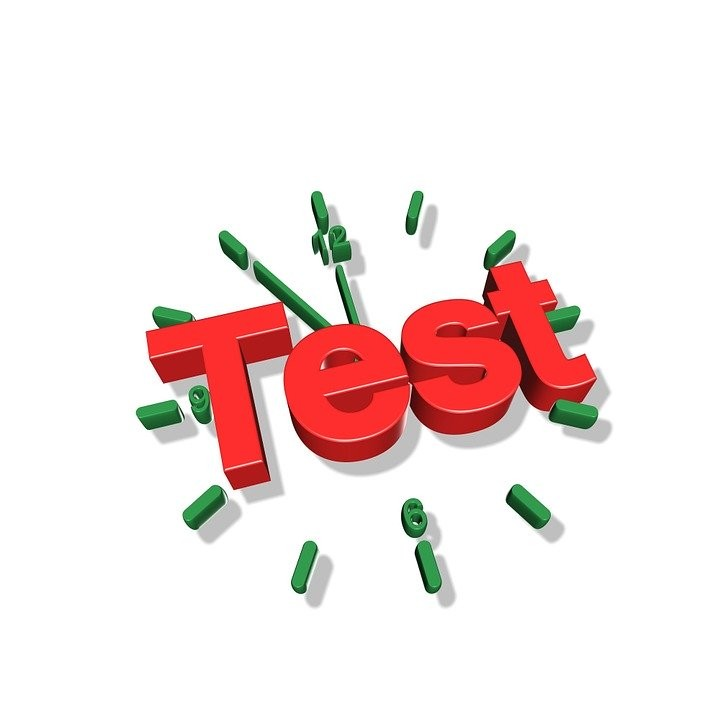

# Упутство за примену теста самосталности

Administrative guidance issued and published by the Tax Administration. Preserved as one historical source-published version.

[Official document](https://www.purs.gov.rs/upload/media/2025/2/4/366523/Uputstvozaprimenutestasamostalnostipdf2.pdf). The original official document is retained byte for byte as source.pdf; tekst.txt preserves its complete text layer in the original script.

Date: 2020-02-26. Official guidance closing date: У Београду, 26.02.2020. године; Број: 000-431-02-142/2020-1000. This is the document date of administrative guidance.

Source images: 4; retained: 4; omitted: 0; normative images: 0. Three decorative cover objects remain in the original PDF; the decorative official page illustration is retained above.

Asset inventory: [shard inventory](../../../../data/rs-poreska-uprava-cont2/assets.tsv).
