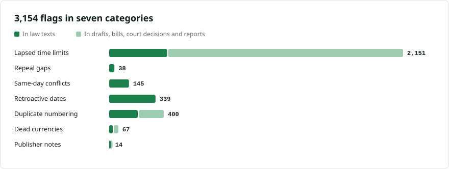

# Vulnerabilities in Serbian law

[Srpski](README.md) · **English**

<picture>
<source media="(prefers-color-scheme: dark)" srcset="img/flags-by-category-dark.svg">

</picture>

The vulnerability detectors from [lexifina/global-law](https://github.com/lexifina/global-law/tree/main/vulnerabilities) look for mechanical mistakes in legislation: a rule applying "until" a date that has passed, a provision repealed before its replacement took effect, two amendments to the same provision on the same day, a rule in force before it was published. global-law's published list (9 November 2026) did not include Serbia yet, so this is a run over this repository only, as it stood at commit [`542a099`](https://github.com/lexifina/serbia-law/commit/542a099cd5a137d6bd315b1596b033ce44dcd54e) on 14 November 2026.

**In short:** the detectors raised 3,154 flags. A language model reviewed 194 of the strongest, arguing each one for and against; 17 survived. Checked by hand in this repository, none of them is a confirmed defect in Serbian law. Eight come from how the register dates versions or how this repository was built, five are lawful, one is a spent transitional rule, and three are not law at all. Later, this will be formalised in Lean, similar to our work on [the US tax code](https://lexifina.com/blog/formalizing-the-us-tax-code) and [US case law](https://lexifina.com/blog/formalizing-all-us-case-law-in-lean).

A flag is a prompt to look, not legal advice, and nothing here has been tested in court.

## Flags by category

| Category | What it looks for | Flags | In law texts | Reviewed | Survived review |
| --- | --- | ---: | ---: | ---: | ---: |
| Lapsed time limits | Text still applying a rule "until" a date that has passed | 2,151 | 424 | 76 | 5 |
| Repeal gaps | A provision removed before its replacement took effect | 38 | 38 | 38 | 4 |
| Same-day conflicts | Two laws changing the same provision on the same day | 145 | 145 | 40 | 4 |
| Retroactive or pre-publication dates | A rule in force before it was made or published | 339 | 339 | 40 | 4 |
| Duplicate numbering | Two units with the same number in one provision | 400 | 209 | 0 | 0 |
| Dead currencies | Amounts in currencies no longer in use | 67 | 26 | 0 | 0 |
| Publisher notes | Notes that an amendment could not be carried out | 14 | 6 | 0 | 0 |

"In law texts" counts laws, by-laws, decisions and treaties. The other flags are in drafts, bills, court decisions and reports, which this repository also holds and labels as not law.

*Edge cases: the 17 flags that survived the review, grouped by what they turned out to be, and what the other flags are, in [EDGE-CASES.en.md](EDGE-CASES.en.md).*

## Problems found in this repository

- **Lost superscripts** in older rulebooks: "dm³" reads "dm?" (for example [pravilnik/1971/sfrj10-190/clan-039.md](https://github.com/lexifina/serbia-law/blob/542a099cd5a137d6bd315b1596b033ce44dcd54e/pravilnik/1971/sfrj10-190/clan-039.md)).
- **Tables the register shows as images** are missing from the files, which can look like a repealed article (the 2020 budget law in [Edge cases](EDGE-CASES.en.md)).
- **Versions dated by the register's application day** can start before the amendment that made them was published (the four open cases in [Edge cases](EDGE-CASES.en.md)).

## Files

| File | What it holds |
| --- | --- |
| [data/flags.csv](data/flags.csv) | Every flag, one row per provision and issue |
| [data/reviewed.csv](data/reviewed.csv) | The 194 flags the model reviewed, with its verdict and reason |
| [data/by_category.csv](data/by_category.csv) | The counts in the table above |
| [tools/](tools/) | The scripts that made this run |

Columns: `category` and `category_sr` (the category in English and Serbian), `detector`, `kind` (`law` or `other`), `path` (the file in this repository), `date` (the date the flag turns on), `reference` (the law or line involved), `summary`, `score` (the detector's ranking, 0 to 1), `review` (`artefact`, `lawful` or `candidate_defect`), `survives_rebuttal`, `review_note` (the model's reason, in English), `url` (the provision or commit at the commit that was read).

## How it was made

- **Detectors:** global-law's [vulnerabilities/scripts](https://github.com/lexifina/global-law/tree/main/vulnerabilities/scripts), run on this repository at commit `542a099`. global-law does not replay Serbia's history yet, so the history table the detectors read was built from this repository's own commit trailers (`Law`, `Kind`, `In-force`).
- **Model review:** gpt-5.4-mini, the 40 strongest flags per category, and for lapsed time limits also the 40 strongest in law texts; one pass says whether a flag is real, a second argues that it is not. Where a flag was reviewed twice, the later review is kept. global-law's own list used a different model.
- **Hand check:** every case that survived was read in this repository's history and texts. The four open dates still need the Службени гласник itself.

To report a correction, open an issue with the provision and an official source.

## Licence

The lists and notes are Lexifina's, dedicated to the public domain under CC0 1.0, like the rest of this repository's own contributions. Quoted law text is as the official register prints it; see [LICENSE](../LICENSE).
